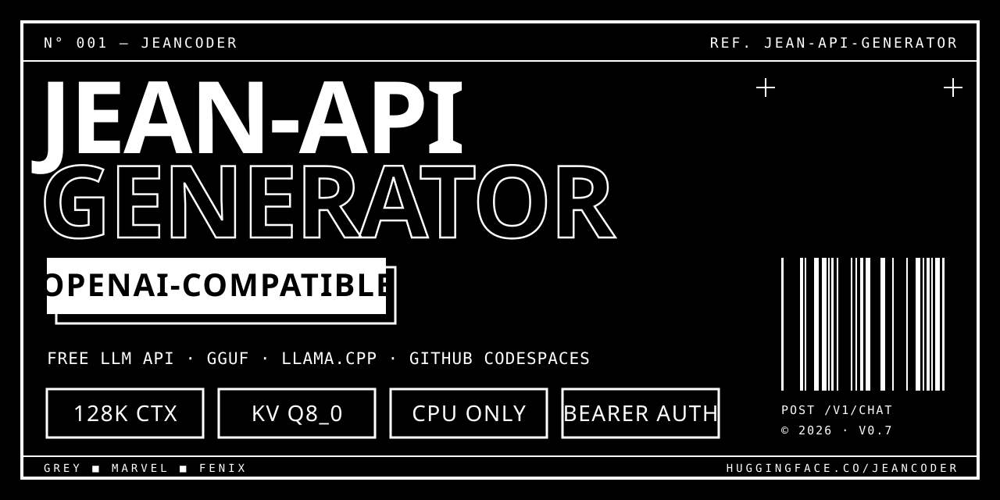

<div align="center">



# jean-api

**Sirve los modelos GGUF Jean v0.7 como una API gratuita compatible con OpenAI usando `llama-server` de `llama.cpp` en un GitHub Codespace (solo CPU).**

[](https://huggingface.co/JeanCoder/jean-models)
[](https://github.com/ggml-org/llama.cpp)

[](https://codespaces.new/jeancodeeer/jean-api)

[English](README.md) · Español

</div>

---

## ¿Qué es?

`jean-api` es la capa de despliegue de los modelos **Jean v0.7** (**Grey**, **Marvel** y **Fénix**, ajustados a partir de Qwen3.5-27B y publicados en GGUF en Hugging Face). Convierte un Codespace de GitHub en un servidor de inferencia de LLM autoalojado que habla la **API de OpenAI** (`/v1/chat/completions`, `/v1/models`): cualquier cliente, editor o agente de código compatible solo necesita cambiar la URL base y la clave.

Nada se ejecuta en tu equipo: tu PC solo es un cliente HTTP.

## Qué hace (comprobable en el código)

- `serve.sh {grey|marvel|fenix}` descarga el GGUF y lanza `llama-server` con autenticación Bearer (`--api-key`).
- Contexto de **128k** (`-c 131072`) con caché KV cuantizada (`-ctk q8_0 -ctv q8_0`).
- Grey (`:8888`) y Marvel (`:8889`) caben a la vez en 16 GB (mediciones en [docs/HISTORY.md](docs/HISTORY.md)).
- Arranque automático según la RAM disponible y *watchdog* que relanza servidores caídos (cada 60 s).
- Modo persistente en `.jean-mode` (`standard` | `fenix`); los GGUF viven en `gguf/` y sobreviven a reinicios.
- `generator/` (bash/PowerShell) y `oracle/setup-vm.sh` (systemd) para ejecutar lo mismo fuera de Codespaces.
- `jean-api.ps1 start|stop|urls|test|status|fenix-mode|standard-mode` para controlar el Codespace desde Windows con `gh`.

## Modelos

Pesos públicos en **[JeanCoder/jean-models](https://huggingface.co/JeanCoder/jean-models)**.

| Modelo | Alias | Rol | Tamaño (Q4_K_M) |
|---|---|---|---|
| Jean Grey | `jean-grey` (:8888) | modelo de código principal | 2,52 GiB |
| Jean Marvel | `jean-marvel` (:8889) | agente / segunda opinión | 4,36 GiB |
| Jean Fénix | `jean-fenix` (:8890) | modelo grande (Qwen3.5-27B + LoRA) | 15,41 GiB |

> Fénix no es usable en un Codespace gratuito de 16 GB (~100 s/token medido con la variante lite IQ3_M). Necesita una máquina ≥ 32 GB.

## Inicio rápido

1. Crea un Codespace desde este repo.
2. Añade los secrets `JEAN_API_KEY` (la clave que tú eliges) y `HF_TOKEN`.
3. Inicia el Codespace: `autostart.sh` lanza Grey y, con ≥ 14 GB de RAM, Marvel.
4. Reenvía los puertos 8888/8889 como públicos (los protege la clave).

```bash
curl -s "https://<tu-url-8888>/v1/chat/completions" \
  -H "Authorization: Bearer $JEAN_API_KEY" -H "Content-Type: application/json" \
  -d '{"model":"jean-grey","messages":[{"role":"user","content":"hola"}]}'
```

Sin cabecera Bearer la API responde `401`; un `503` al despertar significa que el modelo aún está cargando.

## Estructura, límites y más

La estructura del proyecto, los límites conocidos (el Codespace se duerme, solo CPU, 3 modelos a 128k no caben) y el roadmap están en el [README en inglés](README.md). La cronología con pruebas y decisiones está en [docs/HISTORY.md](docs/HISTORY.md).

## Seguridad, contribuir y licencia

Ver [SECURITY.md](SECURITY.md) y [CONTRIBUTING.md](CONTRIBUTING.md). Todavía no hay archivo de licencia publicado; los pesos derivan de [Qwen3.5-27B](https://huggingface.co/unsloth/Qwen3.5-27B-GGUF), revisa su licencia antes de redistribuirlos.
