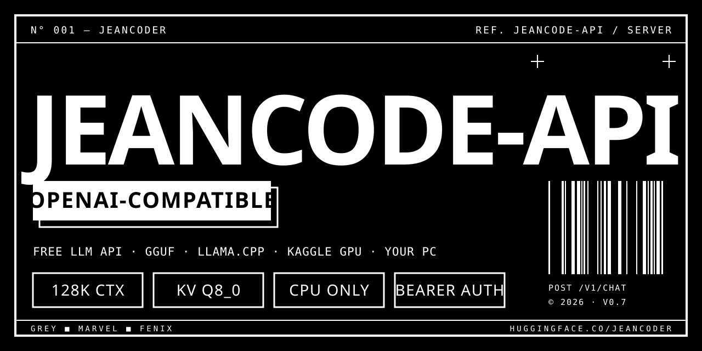

<div align="center">



<br>

# Tu propia API de LLM gratis y compatible con OpenAI — en un Space de Hugging Face

**Sin GPU, sin tarjeta, sin factura de API.** Un Space gratuito de Hugging Face ejecuta [llama.cpp](https://github.com/ggml-org/llama.cpp) `llama-server` con los modelos Jean (o cualquier GGUF de Hugging Face) y te da **una sola URL** que funciona en cualquier cliente compatible con OpenAI: [JeanCode](https://github.com/jeancodeeer/JeanCode), los SDK de OpenAI, `curl` y los agentes o editores que permiten poner una URL base propia.

<br>

[](https://huggingface.co/JeanCoder/jean-models)
[](https://github.com/ggml-org/llama.cpp)

[](https://huggingface.co/spaces/JeanCoder/jean-api?duplicate=true)

[`ENGLISH`](README.md) · **`ESPAÑOL`**

</div>

```
N° 001 — JEANCODE-API                                                REF. V0.7
Sirve los modelos GGUF Jean como una API gratuita compatible con OpenAI.
llama.cpp `llama-server` · Hugging Face Spaces (CPU gratis) · o GitHub Codespaces
```

> [!TIP]
> **¿Prefieres un cliente gráfico?** Conecta **[JeanCode](https://github.com/jeancodeeer/JeanCode)** a tu propio `Jean-API-Generator`: chat, un generador de código con proyectos descargables y un agente de escritorio para Windows, macOS y Linux.

<br>

## 01 — QUÉ ES

`Jean-API-Generator` es la capa de despliegue de los modelos **Jean v0.7** (**Grey**, **Marvel** y **Fénix**, ajustados a partir de Qwen3.5-27B y publicados en GGUF en Hugging Face). Convierte un Space gratuito de Hugging Face (o un Codespace de GitHub) en un servidor de inferencia de LLM autoalojado que habla la **API de OpenAI** (`/v1/chat/completions`, `/v1/models`): cualquier cliente, editor o agente de código compatible solo necesita cambiar la URL base y la clave.

Nada se ejecuta en tu equipo: tu PC solo es un cliente HTTP.

**Por qué usarlo**

- **Gratis y tuyo.** Tu clave, tu Space, tus registros. Nadie se pone entre tú y el modelo.
- **Una URL para todo.** El router (`https://<tu-usuario>-<space>.hf.space/v1`, o `:8899` en un Codespace) expone todos sus modelos, con el contexto real de cada uno.
- **Cualquier GGUF, no solo Jean.** Carga un modelo del Hub de Hugging Face en un puerto sin abrir el Codespace (servidor de control).
- **Honesto con sus límites.** Dice *por qué* un modelo no está disponible (cargando, apagado, no cabe en la RAM) en vez de fallar en silencio. Solo CPU: velocidad de modelo pequeño, no de GPU.

> [!IMPORTANT]
> **Uso personal, tu propio Space.** Este repositorio es una receta que ejecutas en **tu** cuenta, para **ti**: no compartas tu URL ni tu clave y no lo revendas como servicio. El hardware gratuito de Hugging Face ("CPU basic") tiene **2 vCPU y 16 GB de RAM** y no cuesta nada: espera unos pocos tokens por segundo, contexto de 32k por modelo y un Space que **se duerme tras 48 horas sin visitas** (la siguiente petición lo despierta). Fénix (16 GB) no cabe ahí. Para trabajo rápido o pesado, conecta tu cliente a otra API.

**Mejor en pareja.** Combínalo con **[JeanCode](https://github.com/jeancodeeer/JeanCode)**, un agente de programación y cliente de chat sin backend propio (escritorio, web, Android, iOS): pega la URL de este router y tienes un asistente privado sin nadie en el medio.

```bash
# la versión de 30 segundos, con tu Space ya encendido
curl -s https://<tu-usuario>-<space>.hf.space/v1/models -H "Authorization: Bearer $JEAN_API_KEY"
```

<br>

## 02 — QUÉ HACE

Comprobable en el código:

| | |
|---|---|
| **`llama-server` por modelo** | `serve.sh {grey\|marvel\|fenix}` descarga el GGUF y lanza `llama-server` con autenticación Bearer (`--api-key`). |
| **128k de contexto en CPU** | `-c 131072` con caché KV cuantizada (`-ctk q8_0 -ctv q8_0`). |
| **Dos modelos a la vez** | Grey (`:8888`) y Marvel (`:8889`) caben juntos en 16 GB (mediciones en [docs/HISTORY.md](docs/HISTORY.md)). |
| **Arranque y recuperación** | Arranque automático según la RAM disponible y *watchdog* que relanza servidores caídos cada 60 s. |
| **Modo persistente** | `.jean-mode` (`standard` \| `fenix`); los GGUF viven en `gguf/` y sobreviven a reinicios. |
| **Fuera de Codespaces** | `generator/` (bash/PowerShell) y `oracle/setup-vm.sh` (systemd). |
| **Control desde Windows** | `jean-api.ps1 start\|stop\|urls\|test\|status\|fenix-mode\|standard-mode` con `gh`. |

<br>

## 03 — MODELOS

Pesos públicos en **[JeanCoder/jean-models](https://huggingface.co/JeanCoder/jean-models)**.

| MODELO | ALIAS | ROL | TAMAÑO (Q4_K_M) |
|---|---|---|---|
| **JEAN GREY** | `jean-grey` · `:8888` | modelo de código principal | 2,52 GiB |
| **JEAN MARVEL** | `jean-marvel` · `:8889` | agente / segunda opinión | 4,36 GiB |
| **JEAN FÉNIX** | `jean-fenix` | modelo grande (Qwen3.5-27B + LoRA) | 15,41 GiB |

> [!WARNING]
> Fénix no es usable en un Codespace gratuito de 16 GB (~100 s/token medido con una variante reducida). Necesita una máquina ≥ 32 GB.

<br>

## 04 — INICIO RÁPIDO

```
[1] CLAVE       →  elige una clave larga y aleatoria (JeanCode genera una)
[2] DUPLICAR    →  el Space plantilla, hardware "CPU basic" (gratis)
[3] SECRETO     →  JEAN_API_KEY = tu clave, en el diálogo de duplicar
[4] CONECTAR    →  https://<tu-usuario>-<space>.hf.space/v1
```

1. **Elige una clave.** Cualquier texto largo y aleatorio; el botón **Generar** de la pantalla de inicio de JeanCode crea una. Nunca la escribas en un archivo del repositorio.
2. **Duplica el Space:** [abre la plantilla](https://huggingface.co/spaces/JeanCoder/jean-api?duplicate=true), deja el hardware gratuito **CPU basic** y la visibilidad **Public** (la clave lo protege; un Space privado pediría un token de Hugging Face en cada petición).
3. **Pega tu clave** en el campo `JEAN_API_KEY` del mismo diálogo. Se guarda como secreto: nadie puede leerla, ni siquiera el dueño de la plantilla.
4. **Espera 3–6 minutos** a que se construya y descargue el primer modelo, y usa `https://<tu-usuario>-<space>.hf.space/v1` con tu clave. En JeanCode basta con pegar `<tu-usuario>/<space>`.

¿Sin plantilla? Crea un Space nuevo con **SDK: Docker**, sube [`space/Dockerfile`](space/Dockerfile) como su `Dockerfile` y añade el secreto `JEAN_API_KEY` en *Settings → Variables and secrets*. Ese archivo es todo lo que necesita el Space: clona este repositorio al construirse. *Settings → Factory rebuild* trae las versiones nuevas.

### Alternativa: GitHub Codespaces

Crea un Codespace desde este repo ([ábrelo aquí](https://codespaces.new/jeancodeeer/Jean-API-Generator)) con el secreto de Codespaces `JEAN_API_KEY`; `autostart.sh` lanza Grey en `:8888`, Marvel en `:8889` y el router en `:8899`. Gasta tu cuota mensual de Codespaces (120 horas-núcleo en el plan gratuito, unas 30 horas en la máquina de 4 núcleos) y GitHub lo detiene cuando se acaba.

```bash
curl -s "https://<tu-usuario>-<space>.hf.space/v1/chat/completions" \
  -H "Authorization: Bearer $JEAN_API_KEY" -H "Content-Type: application/json" \
  -d '{"model":"jean-grey","messages":[{"role":"user","content":"hola"}]}'
```

| RESPUESTA | SIGNIFICADO |
|---|---|
| `401` | falta la cabecera Bearer o la clave es incorrecta |
| `503` al despertar | el modelo aún está cargando |

### Una sola URL: el router

`https://<tu-usuario>-<space>.hf.space/v1` (o el puerto 8899 de un Codespace) muestra todos los modelos, incluidos los GGUF que cargues desde Hugging Face con [JeanCode](https://github.com/jeancodeeer/JeanCode).
- `"model": "auto"` elige el primero listo (grey > marvel > fenix).
- Si un modelo no está disponible, responde `503` con la lista de los que sí lo están. Nunca cambia de modelo a escondidas.
- `/v1/models` dice qué puerto está caído y por qué, por ejemplo «Fénix no cabe en esta RAM».
- En modo Fénix, el Codespace elige en Hugging Face el GGUF de Fénix que cabe en su memoria.
- `serve.sh` no arranca sin `JEAN_API_KEY`.

<br>

## 04b — BENCHMARK REPRODUCIBLE

Nada de afirmaciones de calidad sin números que puedas repetir. `tests/bench_humaneval.py` ejecuta [HumanEval](https://github.com/openai/human-eval), el banco público de OpenAI, contra **cualquier** API compatible con OpenAI, a temperatura 0 y sin razonamiento, y guarda cada resultado en `bench/humaneval-<modelo>.json`:

```bash
# dentro de un Codespace o contenedor (ejecuta el código que escribe el modelo: no en tu PC)
# contra un Space desde donde sea: añade --base-url https://<tu-usuario>-<space>.hf.space/v1
python3 tests/bench_humaneval.py --model jean-grey --n 40     # los 40 primeros problemas
python3 tests/bench_humaneval.py --model jean-marvel          # los 164
```

Los resultados se publican en [`bench/`](bench/) a medida que se miden, con el subconjunto, la fecha y el tiempo. El mismo script sirve contra Groq, OpenRouter u Ollama local, para comparar en igualdad de condiciones.

## 05 — ESTRUCTURA, LÍMITES Y MÁS

La estructura del proyecto, los límites conocidos (el Codespace se duerme, solo CPU, 3 modelos a 128k no caben) y el roadmap están en el [README en inglés](README.md). La cronología con pruebas y decisiones está en [docs/HISTORY.md](docs/HISTORY.md).

<br>

## 06 — SEGURIDAD · CONTRIBUIR · LICENCIA

Ver [SECURITY.md](SECURITY.md) y [CONTRIBUTING.md](CONTRIBUTING.md). El código de este repositorio se publica bajo licencia [MIT](LICENSE). Los pesos derivan de [Qwen3.5-27B](https://huggingface.co/unsloth/Qwen3.5-27B-GGUF), revisa su licencia antes de redistribuirlos.

<div align="center">

<br>

```
JEANCODER © 2026 — GREY ■ MARVEL ■ FÉNIX
```

</div>
