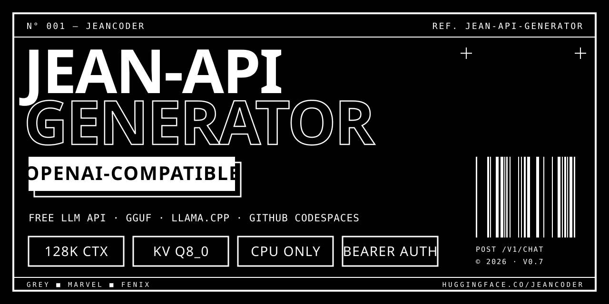

<div align="center">



<br>

[](https://huggingface.co/JeanCoder/jean-models)
[](https://github.com/ggml-org/llama.cpp)

[](https://codespaces.new/jeancodeeer/Jean-API-Generator)

**`ENGLISH`** · [`ESPAÑOL`](README.es.md)

</div>

```
N° 001 — JEANCODE-API                                                REF. V0.7
Serve the Jean GGUF models as a free, OpenAI-compatible API.
llama.cpp `llama-server` · GitHub Codespaces · CPU only · 128k context
```

> [!TIP]
> **Prefer a graphical client?** Point **[JeanCode](https://github.com/jeancodeeer/JeanCode)** at your own `Jean-API-Generator`: chat, a code generator with downloadable projects, and a desktop agent for Windows, macOS and Linux.

<br>

## 01 — WHAT IS THIS

`Jean-API-Generator` is the deployment layer for the **Jean v0.7** models (**Grey**, **Marvel** and **Fénix**, fine-tuned from Qwen3.5-27B and published as GGUF on Hugging Face). It turns a GitHub Codespace into a self-hosted LLM inference server that speaks the **OpenAI API** (`/v1/chat/completions`, `/v1/models`), so any OpenAI-compatible client, editor or coding agent can use the models by changing only the base URL and the API key.

Nothing runs on your own computer: your machine is just an HTTP client.

<br>

## 02 — FEATURES

What the code in this repository actually does:

| | |
|---|---|
| **`llama-server` per model** | `serve.sh {grey\|marvel\|fenix}` downloads the GGUF and starts `llama-server` with Bearer-token authentication (`--api-key`). |
| **128k context on CPU** | Models start with `-c 131072` and a quantized KV cache (`-ctk q8_0 -ctv q8_0`). Native context of the GGUFs is 262144. |
| **Two models side by side** | Grey on `:8888` and Marvel on `:8889` fit together in a 16 GB Codespace at 128k context (measurements in [docs/HISTORY.md](docs/HISTORY.md)). |
| **Auto-start and recovery** | `.devcontainer/autostart.sh` starts the servers at boot, gated by available RAM; `watchdog.sh` checks every 60 s and relaunches a server that stopped answering. |
| **Persistent mode switch** | `.jean-mode` (`standard` or `fenix`) selects which models run and survives rebuilds; GGUF files live in `gguf/` so restarts don't re-download them. |
| **Cloudflare quick tunnels** | `cloudflared` is installed on demand as an optional fallback public URL. |
| **Run it elsewhere** | `generator/` (bash and PowerShell) starts the same stack on Linux / macOS / WSL / Windows with RAM-aware context (≥ 20 GB → 128k, ≥ 12 GB → 64k, otherwise 8k); `oracle/setup-vm.sh` installs it as a **systemd** service. |
| **Windows control script** | `jean-api.ps1 start\|stop\|urls\|test\|status\|fenix-mode\|standard-mode` wakes, tests and switches the Codespace through the `gh` CLI. |
| **Helper tools** | `tools/` has a GGUF header reader, a LoRA integrity check, a GGUF splitter and a script that sets Codespaces secrets from environment variables only. |

<br>

## 03 — THE MODELS

Weights are public on Hugging Face: **[JeanCoder/jean-models](https://huggingface.co/JeanCoder/jean-models)** (no token needed to download).

| MODEL | SERVED AS | ROLE | GGUF | SIZE |
|---|---|---|---|---|
| **JEAN GREY** | `jean-grey` · `:8888` | primary code model | `jean-grey-v0.7.Q4_K_M.gguf` | 2.52 GiB |
| **JEAN MARVEL** | `jean-marvel` · `:8889` | agent / second opinion | `jean-marvel-v0.7.Q4_K_M.gguf` | 4.36 GiB |
| **JEAN FÉNIX** | `jean-fenix` | large model (Qwen3.5-27B + LoRA) | `jean-fenix-v0.7.Q4_K_M.gguf` (+ Q5_K_M, LoRA adapter) | 15.41 GiB |

> [!WARNING]
> **Fénix needs more RAM than a free Codespace has.** On 16 GB a reduced variant loaded but generated at roughly 100 s per token (measured). Run Fénix on a machine with ≥ 32 GB (see `oracle/` and `generator/`).

<br>

## 04 — QUICK START

```
[1] CREATE      →  Codespace from this repo
[2] SECRET      →  JEAN_API_KEY
[3] START       →  autostart.sh launches Grey (+ Marvel with ≥ 14 GB)
[4] PUBLISH     →  forward ports 8888 / 8889 as public
```

1. **Create a Codespace** from this repository ([open it here](https://codespaces.new/jeancodeeer/Jean-API-Generator)). The dev container installs `llama.cpp` (prebuilt CPU binary) and prepares the models.
2. **Add Codespaces secrets** (repository or user level):
   - `JEAN_API_KEY` – the Bearer key your clients must send (you choose it).
   - `HF_TOKEN` – optional; the models repo is public, so every model downloads anonymously.
3. **Start / restart the Codespace.** `postStartCommand` runs `.devcontainer/autostart.sh`, which launches Grey on `:8888` and, with ≥ 14 GB RAM, Marvel on `:8889`.
4. **Make the ports reachable.** Ports 8888/8889 must be forwarded as *public* (the API key protects them). If `GH_PAT` is set as a secret, the Codespace also records its Cloudflare fallback URLs in `~/logs/urls.txt`.

Run a single model by hand inside the Codespace:

```bash
export JEAN_API_KEY=choose-a-long-random-key
PORT=8888 bash serve.sh grey
```

<br>

## 05 — USAGE

Any OpenAI-compatible client works. With `curl`:

```bash
BASE="https://<your-forwarded-8888-url>/v1"

curl -s "$BASE/chat/completions" \
  -H "Authorization: Bearer $JEAN_API_KEY" \
  -H "Content-Type: application/json" \
  -d '{"model":"jean-grey","messages":[{"role":"user","content":"Write a Python function that reverses a string."}]}'
```

With the OpenAI Python SDK:

```python
from openai import OpenAI

client = OpenAI(base_url="https://<your-forwarded-8888-url>/v1", api_key="<JEAN_API_KEY>")
r = client.chat.completions.create(
    model="jean-grey",
    messages=[{"role": "user", "content": "Explain what a mutex is in two sentences."}],
)
print(r.choices[0].message.content)
```

| RESPONSE | MEANING |
|---|---|
| `401` | no or wrong Bearer header |
| `503` right after waking | the model is still loading (about 2–4 minutes for both) |

### Control script for Windows

```powershell
$env:GH_TOKEN = "<a PAT able to manage your codespaces>"   # never commit this
.\jean-api.ps1 start          # wake the Codespace, register ports, print URLs
.\jean-api.ps1 test           # list models, run one chat per model, check that no-key gives 401
.\jean-api.ps1 fenix-mode     # switch to Fénix mode (persistent)
.\jean-api.ps1 standard-mode  # back to Grey + Marvel
.\jean-api.ps1 stop           # stop the Codespace
```

It looks for `gh` in `PATH` (override with `GH_CLI`) and reads the key from `jean_api_key.txt` next to the script (override with `JEAN_API_KEY_FILE`).

### Run on your own machine or VM

```bash
./generator/jean-api-generator.sh start grey            # Linux / macOS / WSL
sudo bash oracle/setup-vm.sh --model fenix --api-key "…" # systemd service on Ubuntu/Debian
```

<br>

## 05a — ONE URL FOR EVERY MODEL (ROUTER)

Port **:8899** is also an OpenAI-compatible router: point any client at `https://<codespace>-8899.app.github.dev/v1` and it sees every model the Codespace is serving, including the GGUFs you load from Hugging Face.

| METHOD | PATH | WHAT IT DOES |
|---|---|---|
| `GET` | `/v1/models` | models ready on every port, plus `jean.unavailable`: which port is down and why (loading, off, "Fénix does not fit in this RAM") |
| `POST` | `/v1/chat/completions` · `/v1/completions` · `/v1/embeddings` | sent to the port that serves `model`, streamed through untouched |
| `GET` | `/health` | public, no data: `{"ok": true, "ready": 2}` |

- `"model": "auto"` picks the first ready model (grey > marvel > fenix > others); a unique partial name also works (`"fenix"`).
- It never switches models silently: an unavailable model gets a `503` with the list of models that are ready, in OpenAI error format, and the client decides.
- Same `JEAN_API_KEY` as every port. The response says which model answered (`X-Jean-Model`).
- Tests: `python tests/test_router.py` (runs in CI with fake llama-servers).

<br>

## 05b — LOAD ANY HUGGING FACE MODEL (CONTROL SERVER)

`control/control_server.py` listens on **:8899** (started by `autostart.sh`, protected by your `JEAN_API_KEY`). A client such as **[JeanCode](https://github.com/jeancodeeer/JeanCode)** uses it to put any GGUF from Hugging Face on one of the model ports without opening the Codespace:

| METHOD | PATH | WHAT IT DOES |
|---|---|---|
| `GET` | `/status` | model per port, free RAM and disk, downloads in progress |
| `POST` | `/load` `{repo, file, slot, hf_token?, ctx?}` | checks disk and RAM, downloads the GGUF to `gguf/custom/` and serves it with `serve.sh custom` |
| `GET` | `/jobs/<id>` | download progress |
| `POST` | `/restore` `{slot}` | back to the Jean model of that port |

`slot` is `8888`, `8889` or `8890`. An HF token, when sent, is used only for that download and never written to disk. Make port 8899 public together with the model ports (`jean-api.ps1 start` does it). A model loaded this way shows up in the router right away. After a Codespace restart the Jean models come back.

**Fénix mode** (`jean-api.ps1 fenix-mode`) picks, from the models repo on Hugging Face, the largest Fénix GGUF that fits the machine's RAM. When none fits (the 15.4 GB Q4 on a 16 GB Codespace), the router reports the reason instead of failing silently. `serve.sh` refuses to start without `JEAN_API_KEY`, so a public port is never served without a key.

<br>

## 06 — STRUCTURE

```
Jean-API-Generator/
├── serve.sh                 # download GGUF + launch llama-server (single source of server flags)
├── jean-api.ps1             # Windows control script (gh CLI)
├── .devcontainer/           # Codespaces: prep, autostart, watchdog, mode switches
├── generator/               # RAM-aware launchers for Linux/macOS/WSL (sh) and Windows (ps1)
├── oracle/setup-vm.sh       # systemd install on a VM
├── tools/                   # GGUF/LoRA utilities, Codespaces secrets helper, project map
├── tests/                   # context (128k) check, diagnostics, Fénix probes
├── docs/HISTORY.md          # measurements, failed attempts and design decisions
└── graphify-out/            # code knowledge graph (generated with graphify)
```

<br>

## 07 — LIMITS

- A Codespace sleeps when idle; the forwarded URLs stop answering until it is woken again.
- Free Codespaces are CPU-only with 16 GB RAM: expect small-model speeds, not GPU speeds. Measured: a one-word answer took 8.4 s on Grey and 3.5 s on Marvel.
- Three models at 128k simultaneously do not fit in 16 GB.

<br>

## 08 — ROADMAP

Derived from the current state of the repository (see [docs/HISTORY.md](docs/HISTORY.md)):

- Serve Fénix on a ≥ 32 GB host (VM or Kaggle CPU kernel) – the only thing the free tier cannot do.
- Rotate and re-inject Codespaces secrets with `tools/set_secrets.py` after any token exposure.

<br>

## 09 — SECURITY · CONTRIBUTING · LICENSE

- **Security:** secrets are passed only through environment variables or Codespaces secrets; never commit keys or Codespace URLs. See [SECURITY.md](SECURITY.md).
- **Contributing:** issues and pull requests are welcome – see [CONTRIBUTING.md](CONTRIBUTING.md). The server flags live only in `serve.sh`; please don't duplicate them.
- **License:** no license file has been published yet, so by default all rights are reserved. The Jean weights derive from [Qwen3.5-27B](https://huggingface.co/unsloth/Qwen3.5-27B-GGUF); check the upstream licence before redistributing them.

<br>

## 10 — CREDITS

[llama.cpp](https://github.com/ggml-org/llama.cpp) (`llama-server`) by ggml-org · Qwen3.5-27B GGUF base by Qwen / [Unsloth](https://huggingface.co/unsloth/Qwen3.5-27B-GGUF) · [Cloudflare quick tunnels](https://github.com/cloudflare/cloudflared) · [graphify](https://github.com/Graphify-Labs/graphify) for the code graph in `graphify-out/`.

<div align="center">

<br>

```
JEANCODER © 2026 — GREY ■ MARVEL ■ FÉNIX
```

</div>
