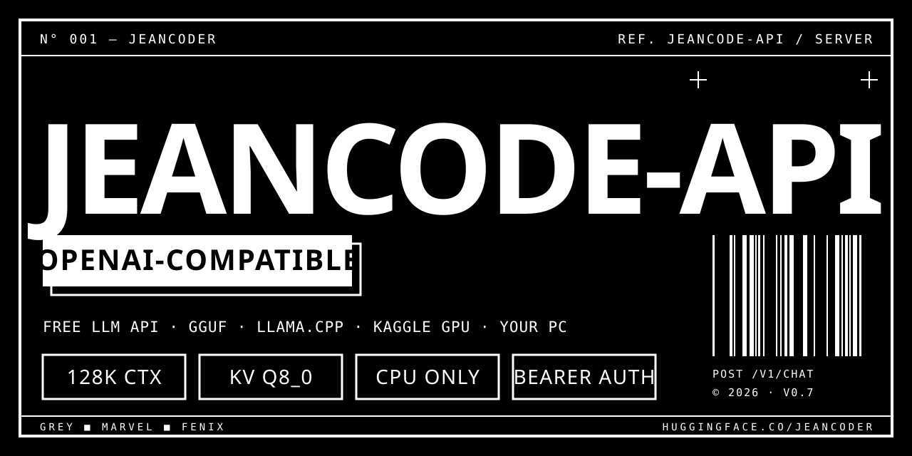

<div align="center">



<br>

# Your own free OpenAI-compatible LLM API

**No credit card, no API bill, no server of mine in the middle.** One command (or one Kaggle notebook) runs [llama.cpp](https://github.com/ggml-org/llama.cpp) `llama-server` with the Jean models (or any GGUF from Hugging Face) and gives you **one URL** that works in every OpenAI-compatible client: [JeanCode](https://github.com/jeancodeeer/JeanCode), the OpenAI SDKs, `curl`, and coding agents or editors that let you set a custom base URL.

<br>

[](https://huggingface.co/JeanCoder/jean-models)
[](https://github.com/ggml-org/llama.cpp)

[](kaggle/jean-api.ipynb)

**`ENGLISH`** · [`ESPAÑOL`](README.es.md)

</div>

```
N° 001 — JEANCODE-API                                                REF. V0.7
Serve the Jean GGUF models as a free, OpenAI-compatible API.
llama.cpp `llama-server` · Kaggle (free GPU) · your PC · any Linux VM
```

> [!TIP]
> **Prefer a graphical client?** Point **[JeanCode](https://github.com/jeancodeeer/JeanCode)** at your own `Jean-API-Generator`: chat, a code generator with downloadable projects, and a desktop agent for Windows, macOS and Linux.

<br>

## 01 — WHAT IS THIS

`Jean-API-Generator` is the deployment layer for the **Jean v0.7** models (**Grey**, **Marvel** and **Fénix**, fine-tuned from Qwen3.5-27B and published as GGUF on Hugging Face). It turns a machine you control into a self-hosted LLM inference server that speaks the **OpenAI API** (`/v1/chat/completions`, `/v1/models`), so any OpenAI-compatible client, editor or coding agent can use the models by changing only the base URL and the API key.

**Where it runs:** on **Kaggle**'s free GPUs (recommended: no card, renewed every week), on **your own PC** (Linux, WSL, Windows or macOS) or on **any Linux VM**. Each person runs it with their own account and their own key: there is no shared server.

**Why people use it**

- **Free and yours.** Your key, your machine, your logs. Nobody else sits between you and the model.
- **One URL for everything.** The router on `:8899` exposes every model you serve, with the real context of each one.
- **Any GGUF, not just Jean.** Serve any GGUF from the Hugging Face Hub, or load one while it runs (control server, below).
- **Honest about limits.** It tells you *why* a model is unavailable (loading, off, does not fit in memory) instead of failing silently.

> [!IMPORTANT]
> **Personal use.** This repository is a recipe you run in **your** account or on **your** machine, for **you**. It is not a hosted service. Kaggle's terms allow personal, non-commercial use, so don't offer your Kaggle URL to others. Do not share your URL or key.

**Part of a pair.** Pair it with **[JeanCode](https://github.com/jeancodeeer/JeanCode)**, a coding agent and chat client with no backend of its own (desktop, web, Android, iOS, pygame): paste this router's URL and you have a private assistant with nobody in the middle.

```bash
# the 30-second version, once it prints its URL
curl -s https://<your-url>/v1/models -H "Authorization: Bearer $JEAN_API_KEY"
```

<br>

## 02 — FEATURES

What the code in this repository actually does:

| | |
|---|---|
| **One launcher** | `launch.py` installs the official llama.cpp build (CUDA when there is an NVIDIA GPU, CPU otherwise; nothing is compiled), serves each model on its own port and GPU, starts the router and opens a public URL. The Kaggle notebook calls the same file. |
| **`llama-server` per model** | `serve.sh {grey\|marvel\|fenix\|custom}` downloads the GGUF and starts `llama-server` with Bearer-token authentication (`--api-key`). It is the single source of server flags. |
| **Long context** | Quantized KV cache (`-ctk q8_0 -ctv q8_0`); context per model is set with `JEAN_CTX` (32k by default with the launcher, up to 128k). Native context of the GGUFs is 262144. |
| **Several models, several GPUs** | Grey and Marvel get one GPU each; Fénix (or a single model) takes all of them. Busy ports are skipped. |
| **Recovery** | The launcher checks every minute and relaunches a model, the router or the tunnel that stopped, showing the end of its log. |
| **Public URL** | A Cloudflare quick tunnel to the router (`https://….trycloudflare.com/v1`). `JEAN_TUNNEL=0` keeps it on `http://127.0.0.1:8899/v1` only. |
| **Native Windows / macOS** | `generator/` (PowerShell and bash) starts a model on your PC with RAM-aware context, listening only on `127.0.0.1`. |
| **Permanent VM** | `oracle/setup-vm.sh` installs a model as a **systemd** service on an Ubuntu/Debian VM (x86_64 or ARM). |
| **Helper tools** | `tools/` has a GGUF header reader, a LoRA integrity check and a GGUF splitter. |

<br>

## 03 — THE MODELS

Weights are public on Hugging Face: **[JeanCoder/jean-models](https://huggingface.co/JeanCoder/jean-models)** (no token needed to download).

| MODEL | SERVED AS | ROLE | GGUF | SIZE |
|---|---|---|---|---|
| **JEAN GREY** | `jean-grey` | primary code model | `jean-grey-v0.7.Q4_K_M.gguf` | 2.52 GiB |
| **JEAN MARVEL** | `jean-marvel` | agent / second opinion | `jean-marvel-v0.7.Q4_K_M.gguf` | 4.36 GiB |
| **JEAN FÉNIX** | `jean-fenix` | large model (Qwen3.5-27B + LoRA) | `jean-fenix-v0.7.Q4_K_M.gguf` (+ Q5_K_M, LoRA adapter) | 15.41 GiB |

> [!WARNING]
> **Fénix needs about 16 GB of GPU memory or ≥ 32 GB of RAM.** On Kaggle it fits across the two T4 GPUs. On a 16 GB CPU machine a reduced variant loaded but generated at roughly 100 s per token (measured, see [docs/HISTORY.md](docs/HISTORY.md)).

<br>

## 04 — QUICK START

### Option A — Kaggle (free GPU, no card): recommended

Kaggle gives every phone-verified account **two NVIDIA T4 GPUs** for free, about 30 hours a week, renewed **every week**. With them the Jean models run on GPU, much faster than any free CPU machine, and even Fénix fits.

```
[1] VERIFY      →  your phone in Kaggle (needed for GPU and internet)
[2] IMPORT      →  kaggle/jean-api.ipynb into a new Kaggle notebook
[3] SETTINGS    →  Accelerator: GPU T4 x2 · Internet: On
[4] SECRET      →  optional: Add-ons → Secrets → JEAN_API_KEY
[5] RUN ALL     →  copy the URL it prints into JeanCode
```

1. In Kaggle: **Create → New Notebook → File → Import Notebook** and pick [`kaggle/jean-api.ipynb`](kaggle/jean-api.ipynb) from this repository.
2. In the right panel, **Settings**: *Accelerator* `GPU T4 x2`, *Internet* `On`.
3. *(Optional)* **Add-ons → Secrets → Add secret**, name `JEAN_API_KEY`, value: a long random key, to keep the same key every session; it never appears in the code or the output. Without it, the notebook creates a key for each session and shows it next to the URL (only you can see your notebook's output).
4. **Run All.** In 3–6 minutes a box shows the URL (`https://….trycloudflare.com/v1`) and the key. Paste both in JeanCode.

**Models:** edit `MODELOS` in the notebook: `grey`, `marvel`, `fenix` (both GPUs), `hf:user/repo/file.gguf` for any GGUF on Hugging Face (add an `HF_TOKEN` secret for private ones), or `file:/kaggle/input/…/model.gguf` for your own GGUF uploaded as a dataset and attached with **Add Input**.

**Limits:** a Kaggle session lasts up to ~12 hours; after that press **Run All** again, and the URL changes.

### Option B — your own PC or any Linux machine

On Linux x86_64 or **WSL** (Windows), with or without an NVIDIA GPU, plus Colab or a VPS:

```bash
git clone https://github.com/jeancodeeer/Jean-API-Generator && cd Jean-API-Generator
python3 launch.py                                   # Grey + Marvel, public URL, key shown once
```

```bash
export JEAN_API_KEY=choose-a-long-random-key        # a fixed key (otherwise one per run)
JEAN_MODELS=grey JEAN_TUNNEL=0 python3 launch.py    # only Grey, only on http://127.0.0.1:8899/v1
JEAN_MODELS=hf:unsloth/Qwen3-4B-GGUF/Qwen3-4B-Q4_K_M.gguf python3 launch.py   # any GGUF
```

It needs Python 3.8+, `bash` and internet the first time. Without a GPU it runs on the CPU: it works, at small-model speeds (measured on 4 cores: a one-word answer in 8.4 s on Grey). Everything it downloads goes to `~/.cache/jean-api` and `gguf/`. `Ctrl+C` stops it all.

**Native Windows or macOS (no WSL):** the scripts in [`generator/`](generator/README.md) start one model on `127.0.0.1`:

```powershell
.\generator\jean-api-generator.ps1 -Model grey       # Windows
```
```bash
./generator/jean-api-generator.sh start grey         # macOS / Linux
```

### Option C — a permanent VM

```bash
sudo bash oracle/setup-vm.sh --model grey --api-key "…"   # systemd service on Ubuntu/Debian
```

Written for Oracle Cloud's Always Free ARM VM (24 GB, enough for Fénix); it works on any Ubuntu/Debian VM.

<br>

## 05 — USAGE

Any OpenAI-compatible client works. With `curl`:

```bash
BASE="https://<your-url>/v1"          # or http://127.0.0.1:8899/v1 on the same machine

curl -s "$BASE/chat/completions" \
  -H "Authorization: Bearer $JEAN_API_KEY" \
  -H "Content-Type: application/json" \
  -d '{"model":"jean-grey","messages":[{"role":"user","content":"Write a Python function that reverses a string."}]}'
```

With the OpenAI Python SDK:

```python
from openai import OpenAI

client = OpenAI(base_url="https://<your-url>/v1", api_key="<JEAN_API_KEY>")
r = client.chat.completions.create(
    model="jean-grey",
    messages=[{"role": "user", "content": "Explain what a mutex is in two sentences."}],
)
print(r.choices[0].message.content)
```

| RESPONSE | MEANING |
|---|---|
| `401` | no or wrong Bearer header |
| `503` right after starting | the model is still downloading or loading (2–5 minutes the first time) |

<br>

## 05a — ONE URL FOR EVERY MODEL (ROUTER)

Port **:8899** is an OpenAI-compatible router: the URL the launcher prints points at it, and it sees every model you serve, including the GGUFs you load from Hugging Face.

| METHOD | PATH | WHAT IT DOES |
|---|---|---|
| `GET` | `/v1/models` | models ready on every port, plus `jean.unavailable`: which port is down and why (loading, off, "Fénix does not fit in this RAM") |
| `POST` | `/v1/chat/completions` · `/v1/completions` · `/v1/embeddings` | sent to the port that serves `model`, streamed through untouched |
| `GET` | `/health` | public, no data: `{"ok": true, "ready": 2}` |
| `GET` `POST` | `/relay/<host>/<path>` | **CORS relay** for web and mobile clients: forwards to APIs that block browsers (NVIDIA NIM, SambaNova, Z.ai…). Only to a fixed list of known provider hosts (plus your own via `JEAN_RELAY_HOSTS`), https only, no redirects. Needs `X-Jean-Key: $JEAN_API_KEY`; the provider key in `Authorization` passes through untouched and is never logged. |

- `"model": "auto"` picks the first ready model (grey > marvel > fenix > others); a unique partial name also works (`"fenix"`).
- It never switches models silently: an unavailable model gets a `503` with the list of models that are ready, in OpenAI error format, and the client decides.
- Same `JEAN_API_KEY` as every port. The response says which model answered (`X-Jean-Model`).
- Tests: `python tests/test_router.py` (runs in CI with fake llama-servers).

<br>

## 05b — LOAD ANY HUGGING FACE MODEL WHILE IT RUNS (CONTROL SERVER)

`control/control_server.py` is the same process on **:8899**, protected by your `JEAN_API_KEY`. A client such as **[JeanCode](https://github.com/jeancodeeer/JeanCode)** uses it to put any GGUF from Hugging Face on one of the model ports without touching the machine:

| METHOD | PATH | WHAT IT DOES |
|---|---|---|
| `GET` | `/status` | model per port, free RAM and disk, downloads in progress |
| `POST` | `/load` `{repo, file, slot, hf_token?, ctx?}` | checks disk and RAM, downloads the GGUF to `gguf/custom/` and serves it with `serve.sh custom` |
| `GET` | `/jobs/<id>` | download progress |
| `POST` | `/restore` `{slot}` | back to the Jean model of that port |

`slot` is one of the model ports. An HF token, when sent, is used only for that download and never written to disk. A model loaded this way shows up in the router right away and goes on the GPU when there is one. After a restart the models in `JEAN_MODELS` come back. `serve.sh` refuses to start without `JEAN_API_KEY`, so a port is never served without a key.

<br>

## 06 — STRUCTURE

```
Jean-API-Generator/
├── launch.py                # the launcher: llama.cpp + models + router + tunnel + recovery (any Linux)
├── serve.sh                 # download GGUF + launch llama-server (single source of server flags)
├── kaggle/                  # Kaggle notebook (calls launch.py)
├── control/                 # router and control server on :8899
├── generator/               # native Windows (ps1) and macOS/Linux (sh) launchers, RAM-aware
├── oracle/setup-vm.sh       # systemd install on a VM
├── tools/                   # GGUF/LoRA utilities, project map
├── tests/                   # router and launcher tests, 128k context check, benchmark
├── docs/HISTORY.md          # measurements, failed attempts and design decisions
└── graphify-out/            # code knowledge graph (generated with graphify)
```

<br>

## 06b — BENCHMARK (REPRODUCIBLE)

No quality claims without numbers you can rerun. `tests/bench_humaneval.py` runs OpenAI's public [HumanEval](https://github.com/openai/human-eval) against **any** OpenAI-compatible endpoint, at temperature 0, with reasoning off, and writes every result to `bench/humaneval-<model>.json`:

```bash
# it executes the code the model writes: run it on Kaggle, a VM or a container, not on your own PC
python3 tests/bench_humaneval.py --base-url http://localhost:8899/v1 --model jean-grey --n 40
python3 tests/bench_humaneval.py --base-url http://localhost:8899/v1 --model jean-marvel   # all 164
```

The same script works against Groq, OpenRouter or a local Ollama, so you can compare like for like.

## 07 — LIMITS

- Kaggle: sessions of up to ~12 hours and about 30 GPU hours a week; the URL changes on every run.
- The quick tunnel URL is public: the key protects it. Without a GPU, expect small-model speeds.
- `launch.py` needs Linux x86_64 (WSL counts); on native Windows or macOS use `generator/`.

<br>

## 08 — SECURITY · CONTRIBUTING · LICENSE

- **Security:** secrets go only through environment variables or Kaggle Secrets; never commit keys or URLs. See [SECURITY.md](SECURITY.md).
- **Contributing:** issues and pull requests are welcome – see [CONTRIBUTING.md](CONTRIBUTING.md). The server flags live only in `serve.sh`; please don't duplicate them.
- **License:** [MIT](LICENSE) for the code in this repository. The Jean weights derive from [Qwen3.5-27B](https://huggingface.co/unsloth/Qwen3.5-27B-GGUF); check the upstream licence before redistributing them.

<br>

## 09 — CREDITS

[llama.cpp](https://github.com/ggml-org/llama.cpp) (`llama-server`) by ggml-org · Qwen3.5-27B GGUF base by Qwen / [Unsloth](https://huggingface.co/unsloth/Qwen3.5-27B-GGUF) · [Cloudflare quick tunnels](https://github.com/cloudflare/cloudflared) · [graphify](https://github.com/Graphify-Labs/graphify) for the code graph in `graphify-out/`.

<div align="center">

<br>

```
JEANCODER © 2026 — GREY ■ MARVEL ■ FÉNIX
```

</div>
